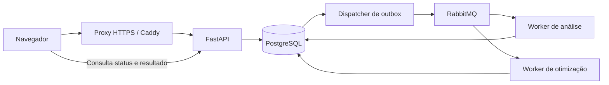

# Arquitetura — candidata 0.2.0rc1

Esta versão é uma candidata para homologação. Uma execução de testes não equivale a uma certificação de segurança, capacidade ou disponibilidade em produção.

## Limites de responsabilidade

- `domain/`: entidades e opções em dataclasses; calendário, regras, políticas e contratos. Importa somente a biblioteca padrão e o próprio domínio.
- `application/`: casos de uso, identidade autorizada, política de capacidade e portas. Não contém endpoints.
- `infrastructure/database/`: SQLAlchemy, transações, snapshots de projeto, revisões e filas persistentes.
- `infrastructure/security/`: Argon2id e sessões opacas persistidas por hash.
- `infrastructure/messaging/`: Celery, publicação confirmada, outbox, execução e recuperação.
- `infrastructure/optimization/`: tradução para OR-Tools e execução dos modelos matemáticos.
- `api/`: validação de entrada, autenticação, CSRF, autorização e composição do SaaS.
- `presentation/local.py`: compatibilidade explicitamente local, sem autenticação. Nunca é montada pelo SaaS.

A aplicação usa uma role PostgreSQL de dados sem superusuário, criação de bancos, roles ou tabelas. Migrações usam uma role distinta; credenciais administrativas/migratórias não são injetadas na API ou nos workers. Cada operação utiliza uma sessão SQL própria. A instância `Session` não é compartilhada entre requisições, threads ou tarefas. API e workers não compartilham arquivos de projetos.

## ADR-001 — PostgreSQL e snapshots versionados

Identidades, empresas, sessões, revisões, jobs, auditoria e outbox são relacionais. O conteúdo de uma escala é um documento JSONB validado pelos contratos existentes: preserva ciclos compostos, jornadas semanais, vigências e backups sem uma normalização prematura em dezenas de tabelas. Consultas analíticas transversais futuras podem exigir projeções específicas.

A chave de projeto é `(organization_id, id)`. Todas as operações de projetos, usuários e resultados incluem a empresa obtida da sessão autenticada. Um usuário pertence a uma empresa nesta versão. O cliente não escolhe a empresa por parâmetro de consulta, cabeçalho ou corpo da requisição. Não há RLS do PostgreSQL nesta candidata; o isolamento é aplicado pelos repositórios e verificado pelos testes. Conexões SQL não devem ser disponibilizadas a clientes.

Escritas de projetos exigem `If-Match`, usam atualização condicional por revisão e serializam operações relacionadas pela linha da empresa. Retornam `ETag`; uma revisão obsoleta retorna 412, e a ausência de precondição retorna 428. Alterações propagadas a grupos vinculados incrementam também a revisão das subdivisões afetadas. Isso evita sobrescritas silenciosas por outra aba.

Importações são aditivas, geram novos identificadores de projetos e vínculos e não sobrescrevem escalas existentes. O JSON anterior continua sendo aceito pela fronteira de importação. Não há migração automática e silenciosa de arquivos locais para uma empresa.

## ADR-002 — Sessões no servidor

Senhas usam Argon2id, com duas operações de derivação simultâneas por processo para limitar o consumo de memória. O navegador recebe um token aleatório em cookie HttpOnly, Secure em produção, SameSite=Strict, sem atributo Domain. O banco armazena somente seu SHA-256; uma cópia do banco não fornece tokens de sessão utilizáveis.

Sessões têm validade absoluta de oito horas e inatividade de sessenta minutos por padrão. Logout revoga a sessão; troca/recuperação de senha e alteração/desativação de usuário revogam suas sessões. O estado ativo e a permissão são consultados novamente em cada requisição.

Requisições mutáveis exigem origem exata e token CSRF vinculado à sessão. SameSite é defesa adicional, não substitui CSRF. Tokens não são armazenados em localStorage. Login tem limitação persistida por conta e por endereço de conexão, respostas genéricas e verificação Argon2 mesmo para emails inexistentes. Ao implantar atrás de proxy, configure a política de endereço/limites descrita no runbook.

Permissões:

| Operação | Leitura | Editor | Administrador |
| --- | --- | --- | --- |
| Ler escalas e resultados da própria empresa | Sim | Sim | Sim |
| Solicitar análise/exportação | Sim | Sim | Sim |
| Salvar, importar, excluir, reutilizar grupos e otimizar | Não | Sim | Sim |
| Cancelar o próprio job | Sim | Sim | Sim |
| Gerenciar usuários e cancelar jobs de terceiros | Não | Não | Sim |

Não há cadastro público. Um operador provisiona a empresa e o primeiro administrador pela CLI, sem senha em argumentos ou logs. Administradores criam usuários da própria empresa. A aplicação impede remover o último administrador ativo. Recuperação de senha nesta candidata é operacional pela CLI; não existe envio de email, MFA, SSO nem fluxo de convites.

## ADR-003 — RabbitMQ, Celery e outbox transacional

Aceitar um job grava o snapshot, a chave de idempotência e uma mensagem de outbox na mesma transação. A API responde 202, sem rodar OR-Tools nem a análise anual. O dispatcher publica somente IDs, usando confirmação do broker, e registra a entrega. Se o broker estiver fora, o job permanece no banco e a publicação é repetida com backoff.

A entrega é **pelo menos uma vez**, não exatamente uma vez. Um worker faz uma transição condicional `queued → running` com identificador de execução e lease. Mensagens duplicadas não iniciam outra execução de um job já em processamento ou terminado. A gravação do resultado exige o mesmo identificador e estado: uma execução antiga não sobrescreve o resultado após recuperação/cancelamento.

Workers usam confirmação após execução, prefetch 1, uma tarefa por processo simultaneamente na configuração Compose, filas distintas, limite brando de 150 s e duro de 180 s. O lease padrão é de 240 s. O dispatcher recupera leases expirados; após três tentativas o job fica `failed`. Falhas de cálculo ficam explícitas; não se repetem indefinidamente.

Cancelar invalida o resultado. Um cálculo nativo já iniciado pode continuar consumindo CPU até terminar ou atingir o limite; não há garantia de interrupção imediata. Resultados são dados de proposta e nunca salvam automaticamente a escala. O usuário deve aplicar a proposta, sujeito à revisão atual do projeto.

Há no máximo quatro jobs ativos por empresa por padrão. Cada trabalho aceita até vinte turnos, duzentos grupos/equipes alocadas, vinte e quatro vigências e dez mil padrões/fases de busca. O corpo HTTP é limitado a 2 MB. Esses são limites operacionais da candidata, não novas regras trabalhistas.

Jobs concluídos e respectivos snapshots/resultados são retidos por sete dias por padrão; o dispatcher executa limpeza horária. Projetos e eventos de auditoria não são removidos por essa limpeza. A retenção empresarial e de auditoria deve ser definida pelo responsável pela operação.

## Referências de implementação

- [SQLAlchemy: sessões por thread/tarefa](https://docs.sqlalchemy.org/en/20/orm/session_basics.html#is-the-session-thread-safe-is-asyncsession-safe-to-share-in-concurrent-tasks)
- [Celery: idempotência e confirmação tardia](https://docs.celeryq.dev/en/stable/userguide/tasks.html)
- [OWASP: armazenamento de senhas](https://cheatsheetseries.owasp.org/cheatsheets/Password_Storage_Cheat_Sheet.html)
- [OWASP: sessões](https://cheatsheetseries.owasp.org/cheatsheets/Session_Management_Cheat_Sheet.html)
- [OWASP: CSRF](https://cheatsheetseries.owasp.org/cheatsheets/Cross-Site_Request_Forgery_Prevention_Cheat_Sheet.html)

Os canais de eventos/controle do Celery usam filas temporárias **exclusivas**, compatíveis com RabbitMQ 4.3; as filas de trabalhos continuam duráveis. Não foi reativado o recurso obsoleto de filas transitórias não exclusivas. Perda de conexão ao broker cancela tarefas longas no processo do worker; a recuperação permanece governada pelo estado/lease no PostgreSQL.
